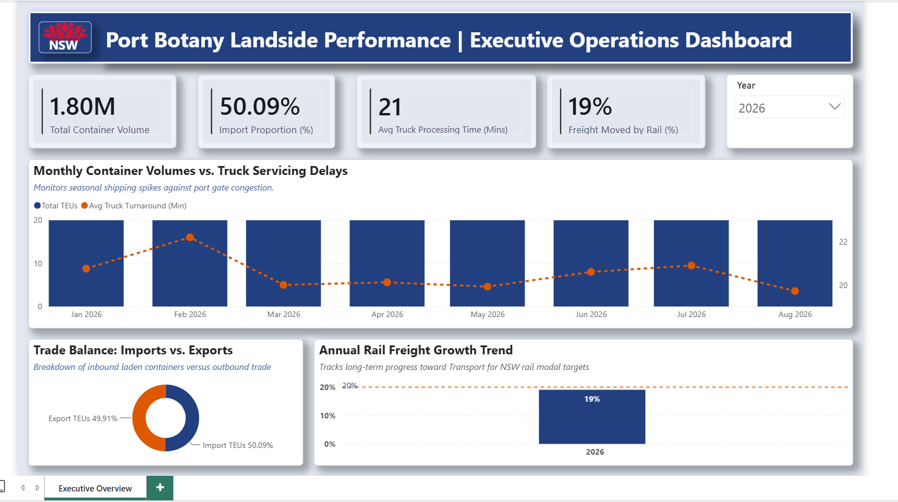

# Port Botany Landside Freight Analysis

An executive Power BI dashboard that tracks container throughput, truck turnaround, import/export balance, and rail modal share at Port Botany — Sydney’s main container port.



*Executive Overview page (2026 selected)*

## Business problem

Landside performance at Port Botany is usually reviewed across separate operational reports. This dashboard puts the main signals on one page so congestion, trade balance, and progress toward the state’s rail-freight target can be checked quickly.

It is designed around four operational questions:

1. **Gate congestion.** Are truck turnaround times staying inside a 35-minute servicing target, including during volume spikes?
2. **Rail modal shift.** Is a growing share of containers moving by rail, toward Transport for NSW’s 20%+ target (shown on the report as “2026 Target: 20%+”)?
3. **Trade balance.** Are imports and exports reasonably in balance, or is the yard at risk of filling with unpaired containers?
4. **A single view for stakeholders.** Stevedores, road operators, rail managers, and government teams can look at the same monthly figures instead of reconciling separate spreadsheets.

## Dataset and source

- **Source workbook:** [`data/port-botany_20260602.xlsx`](data/port-botany_20260602.xlsx)
- **Publication:** Transport for NSW Freight Data Board, Electronic Publication No. TPA-DAR-FDB-0005-Port Botany
- **Data owners named in the workbook:** Freight Operations, Transport for NSW, Port Authority, NSW Ports, and the Australian Bureau of Statistics (ABS), with trade-tonne data provided by Maritrade
- **Coverage:** monthly operational series from January 2005 to April 2026
- **Fields used in the model:** monthly throughput, import and export TEUs, container truck turnaround time (minutes), and TEUs moved by rail

TEU (twenty-foot equivalent unit) is the standard measure of container volume. Throughput, turnaround, and rail fields used in the measures are populated from early 2016; earlier years in the workbook do not have those columns filled.

The workbook’s own disclaimer applies: while care is taken in producing the work, no responsibility is taken or warranty made with respect to the accuracy of any information, data or representation.

## Tools and skills

- Power BI Desktop
- Power Query / import from Excel
- Star-schema modelling (fact table + `Dim_Date`)
- DAX measures for volume, shares, and average turnaround
- Combo chart, column chart with a constant target line, donut chart, and KPI cards
- Custom theme (`port-botany-theme.json`, Industrial Balance Slate Copper), including a navy/orange palette chosen so the main series remain distinct for colour-blind viewers

## Data model

```
Dim_Date[Date]  <---  Port Botany Operations[Month]
                              |
                         _Measures  (measure table)
```

- **`Port Botany Operations`** — one row per month of port activity.
- **`Dim_Date`** — calculated date table from 1 January 2016 to 31 December 2026 (`Year`, `Month Name`, `Month Number`, `Quarter`, `Year Month`).
- **`_Measures`** — a dedicated measure table. A year slicer on `Dim_Date[Year]` filters the page.

`Dim_Date` is defined as:

```dax
ADDCOLUMNS (
    CALENDAR ( DATE ( 2016, 1, 1 ), DATE ( 2026, 12, 31 ) ),
    "Year", YEAR ( [Date] ),
    "Month Name", FORMAT ( [Date], "MMMM" ),
    "Month Number", MONTH ( [Date] ),
    "Quarter", "Q" & FORMAT ( [Date], "Q" ),
    "Year Month", FORMAT ( [Date], "YYYY-MM" )
)
```

## Key DAX measures

```dax
Total TEUs =
SUM ( 'Port Botany Operations'[Monthly Throughput Volumes (TEUs)  ] )
```

```dax
Import TEUs = SUM ( 'Port Botany Operations'[Monthly Import Volumes (TEUs)] )
Export TEUs = SUM ( 'Port Botany Operations'[Monthly Export Volumes (TEUs)] )

Import Share % =
DIVIDE ( [Import TEUs], [Import TEUs] + [Export TEUs], 0 )
```

```dax
Avg Truck Turnaround (Min) =
AVERAGE ( 'Port Botany Operations'[Container Turnaround Time (mins)] )
```

```dax
Rail Share % =
DIVIDE (
    SUM ( 'Port Botany Operations'[Total TEUs by rail to & from Port Botany] ),
    [Total TEUs],
    0
)
```

Card labels on the page use display names: Total Container Volume, Avg Truck Processing Time (Mins), Freight Moved by Rail (%), and Import Proportion (%).

## Dashboard pages

One page: **Executive Overview** (`Port Botany Landside Performance | Executive Operations Dashboard`).

| Visual | What it shows |
| --- | --- |
| KPI cards | Total container volume, average truck processing time, freight moved by rail, and import proportion |
| Year slicer | Filters the page to one or more years |
| `Monthly Container Volumes vs. Truck Servicing Delays` | Combo chart of monthly `Total TEUs` against average truck turnaround. Subtitle: “Monitors seasonal shipping spikes against port gate congestion.” |
| `Annual Rail Freight Growth Trend` | Rail share by year, with a reference line at 20% labelled “2026 Target: 20%+”. Subtitle: “Tracks long-term progress toward Transport for NSW rail modal targets.” |
| `Trade Balance: Imports vs. Exports` | Donut of import TEUs vs export TEUs. Subtitle: “Breakdown of inbound laden containers versus outbound trade.” |

## Key insights

Figures below were calculated from the official source workbook (sum of monthly throughput, average of monthly turnaround, rail TEUs ÷ total TEUs). 2026 is January–April only, so it is not a full year.

- **Volume.** From March 2016 to April 2026 the series totals **25.1 million TEUs**. The busiest full year in the file is **2024 at 2.62 million TEUs**. **2025 was 2.59 million TEUs**, about **1.0% below** 2024.
- **Truck turnaround.** Average turnaround rose from about **18 minutes** in 2016–2017 to a high of **25.0 minutes** in 2020, then improved to **21.0 minutes** in 2025 (versus 22.8 minutes in 2024). Across all 122 months with data, **no month exceeded the 35-minute target** described in the project notes. The highest monthly average was **30.8 minutes** in 2024.
- **Rail share.** Rail’s share of throughput has not yet reached the **20%** line shown on the chart. The highest full year in the file is **2017 at 19.3%**. Share then fell to **14% in 2021 and 2022**, and recovered to **18.0% in 2025**. In January–April 2026 it was **19.0%**.
- **Trade balance.** In years with complete import and export TEU data, the split is essentially even (about **50–51% imports**).

## How to open the file

1. Install [Power BI Desktop](https://www.microsoft.com/power-platform/products/power-bi/desktop).
2. Open `Port Botany Project.pbix`.
3. If the Excel source path still points to the original computer, go to **Transform data → Data source settings**, and redirect it to `data/port-botany_20260602.xlsx` in this folder, then refresh.

To apply the theme in a new report: **View → Themes → Browse for themes** and select `port-botany-theme.json`.

## Author

[Sana Adnan](https://github.com/sanaadnanc) · Data Analyst, Sydney
